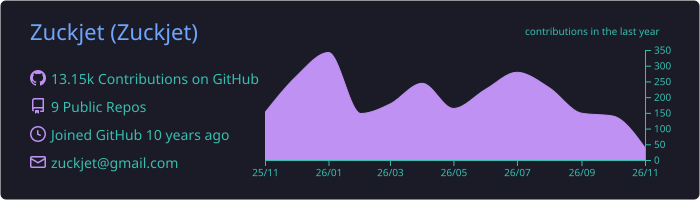
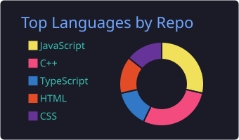
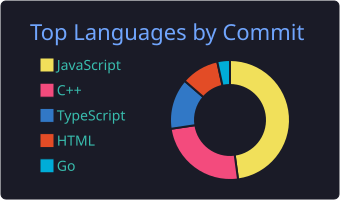
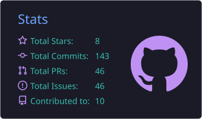
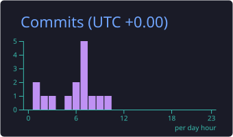

<!-- Header -->

  

  

  
  
  

---

### 🙋‍♂️ About Me

- 🌏 I'm based in **Shenzhen, China**
- 💻 I'm a developer who **enjoys coding**, mainly working with **JavaScript / TypeScript**
- 🔭 I'm currently working on developer tools such as [**mock-type**](https://github.com/Zuckjet/mock-type)
- 🌱 I'm currently exploring **Flutter** and cross-platform development
- 👯 I'm open to collaborating on interesting open source projects
- ⚡ Fun fact: I believe good tools make developers happy

### 🛠️ Tech Stack

  <a href="https://skillicons.dev">
    
     
    
  </a>

### 📌 Featured Project

| Project | Description | Stars |
| :-- | :-- | :-: |
| [**mock-type**](https://github.com/Zuckjet/mock-type) | A tool to create mock data from TypeScript interfaces |  |

### 📊 GitHub Stats

  

  
  

  
  

  

### 🐍 Contribution Snake

  <picture>
    <source media="(prefers-color-scheme: dark)" srcset="./dist/github-snake-dark.svg" />
    <source media="(prefers-color-scheme: light)" srcset="./dist/github-snake.svg" />
    
  </picture>

📈 Stats cards and snake are regenerated daily by [GitHub Actions](./.github/workflows/profile.yml).

<!-- Footer -->

  

